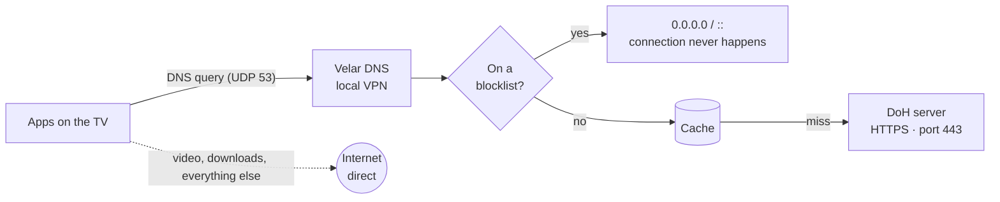

<p align="center">
  
</p>

<p align="center">
  <a href="https://github.com/Velar-Labs/velar-dns/releases/latest"></a>
  <a href="https://github.com/Velar-Labs/velar-dns/releases"></a>
  <a href="https://github.com/Velar-Labs/velar-dns/actions/workflows/build.yml"></a>
  
  
</p>

<p align="center">
  <b>English</b> · <a href="README.pt-BR.md">Português (Brasil)</a>
</p>

---

**Velar DNS** encrypts every DNS lookup your TV makes and blocks known malware and phishing domains before a connection is ever made. It is built for the living room: a lightweight app that you control entirely with the remote, that starts with the TV, and that stays out of the way of your streaming.

Only DNS queries go through the app. Your video, downloads and everything else keep flowing directly over your normal connection — no speed loss, no third-party server in the middle.

<p align="center">
  <a href="https://github.com/Velar-Labs/velar-dns/releases/latest/download/velar-dns.apk"></a>
</p>

## Features

| | |
|---|---|
| 🔒 **Encrypted DNS (DoH)** | Queries are sent over HTTPS (port 443, RFC 8484) to the server you choose. Nobody on the network path can read or tamper with them. |
| 🛡️ **Threat protection** | ~170,000 known malware and phishing domains are blocked locally, before resolution. Blocked domains get `0.0.0.0` (IPv4) and `::` (IPv6). |
| 🌐 **Choose your server** | Cloudflare, Google, Quad9, AdGuard, or any custom DoH address. Built-in speed test for all servers. |
| 🔁 **Automatic failover** | After 3 consecutive failures, Velar DNS switches to the next server on its own. |
| ⚡ **DNS cache** | Answers are kept in memory for their TTL (max. 10 min), so pages and apps open faster. |
| 📊 **Stats on the device** | Blocks from the last 7 days and the most blocked domains — stored only on the TV. |
| ✅ **One-click allowlist** | Something legitimate got blocked? Press **OK** on it in *Recent blocks* to allow it. Press OK again to block it back. |
| 🩺 **Diagnostics** | One screen that tests the network, the DoH servers and the protection lists. |
| 📺 **Made for the remote** | Jetpack Compose UI designed for D-pad navigation. Starts with the TV and supports Android's *Always-on VPN*. |
| 🔄 **Auto-updated lists** | Protection lists refresh every 24 hours in the background. |

## How it works

Velar DNS creates a **local** VPN on the device. It is not a VPN to a remote server: the tunnel only captures DNS traffic and never leaves your TV.



The app connects to each DoH server through its fixed IP addresses, so it does not depend on (or trust) the DNS of the network it is on.

## DNS servers

| Server | Address | Best for |
|---|---|---|
| **Cloudflare** | `cloudflare-dns.com` | Speed, no filtering |
| **Google** | `dns.google` | Stability, no filtering |
| **Quad9** | `dns.quad9.net` | Extra malicious-domain filtering on the server side |
| **AdGuard** | `dns.adguard-dns.com` | Ad blocking |
| **Custom** | any `https://…/dns-query` | Your own or another DoH provider |

## Installation

1. On the TV, allow installing apps from unknown sources for the app you will use to install (browser, file manager or a downloader app).
2. Download the APK from the link below and open it:
   ```
   https://github.com/velar-labs/velar-dns/releases/latest/download/velar-dns.apk
   ```
   This link always points to the newest version.
3. Open **Velar DNS**, press **OK** on **Ativar** (*Activate*) and accept Android's VPN permission request (only the first time).

> The app interface is currently in Portuguese.

**Updating:** install the new APK over the current one. Your settings are kept.

### Recommended settings

- **Always-on VPN:** in *Settings → Always-on VPN*, select Velar DNS. This gives maximum stability.
- **Private DNS:** if the TV shows *"Private DNS server cannot be accessed"*, turn off **Private DNS** in Android's network settings.

## Privacy

- Only DNS queries enter the tunnel. The rest of your traffic is never seen by the app.
- Blocklists, statistics and your allowlist live **only on the device**. Your DNS history is never sent anywhere.
- Protection lists are downloaded from their public sources (GitHub and phishing.army).
- **Anonymous install counter (since 1.2.0):** each install creates a random ID. While protection is on, the app sends that ID and the app version to our server every 30 minutes, so we know how many devices are active. It does **not** send your name, account, websites visited or DNS queries. See [`stats/DeviceCounter.kt`](app/src/main/java/app/velardns/stats/DeviceCounter.kt).

## Good to know

- Android allows only **one VPN app** at a time. Turning on another VPN turns Velar DNS off.
- Reconnecting automatically after a reboot depends on the VPN permission staying valid and on each TV Box's firmware.
- Protection uses about **10–15 MB of RAM** for the domain lists — fine for most TV Boxes.
- Protection is on by default and can be turned off on the **Protection** screen.

## Build from source

Requirements: **JDK 17** and **Android Studio Ladybug** or newer.

```bash
git clone https://github.com/Velar-Labs/velar-dns.git
cd velar-dns
./gradlew assembleRelease
```

Or in Android Studio: **Open** → select this folder → **Build → Build APK(s)**.

Every push to `main` builds the APK on GitHub Actions. Publishing releases and configuring the signing key are described in [docs/RELEASING.md](docs/RELEASING.md).

<details>
<summary><b>Project structure</b></summary>

| Path | What it does |
|---|---|
| `vpn/VelarVpnService.kt` | Local VPN. Virtual address `10.111.222.2`, virtual DNS `10.111.222.1`. Only the virtual DNS route (and, with *Force all DNS*, known public DNS servers) enters the tunnel. |
| `dns/Packets.kt` | Reads IPv4/UDP packets on port 53 and builds the replies. |
| `dns/Doh.kt` | DoH client (RFC 8484) with fixed server IPs and automatic failover. Checks each domain against the blocklists before querying. |
| `dns/DnsCache.kt` | In-memory cache that respects TTL. |
| `filter/` | Blocking engine: `DomainMatcher` (O(1) HashSet with subdomain matching), `BlocklistManager` (download, cache and merge), `BlockLog` (last 200 blocks), `BlockStats` (7-day and top domains), `BlocklistUpdater` (every 24 h). |
| `diag/Diagnostics.kt` | Tests behind the Diagnostics screen. |
| `ui/` | Jetpack Compose screens, navigable with the remote. |

</details>

## Credits

Threat protection is powered by public, community-maintained lists:

- [**Steven Black hosts**](https://github.com/StevenBlack/hosts) — malware and phishing domains
- [**Phishing Army**](https://phishing.army) — confirmed phishing domains

DNS resolution is provided by the DoH services listed above. Velar DNS is not affiliated with any of them.

---

<p align="center">
  Made by <b>Velar Labs</b>
</p>
