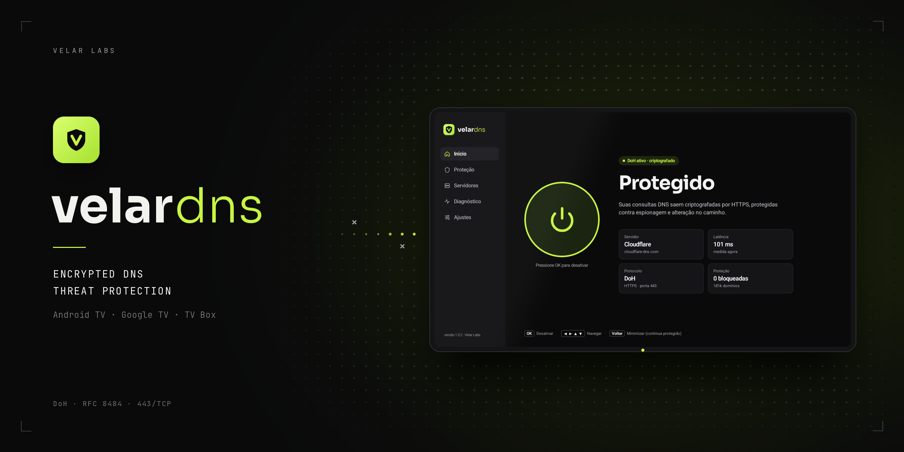
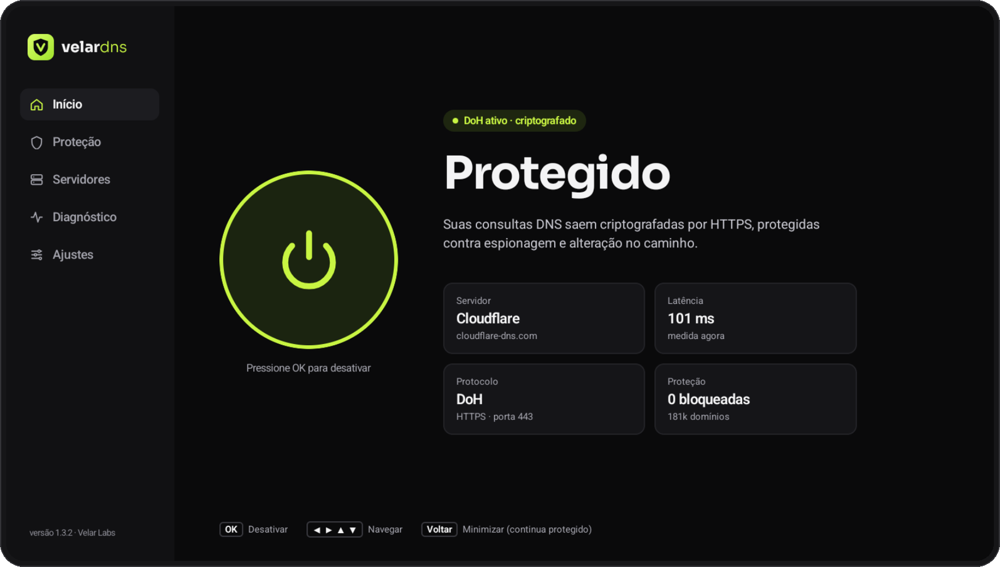
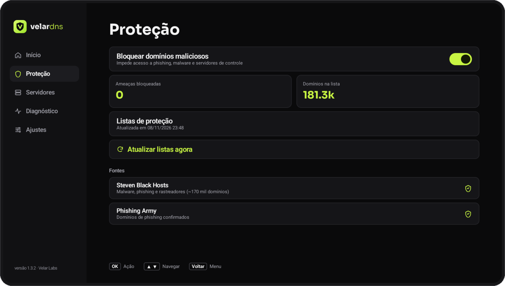
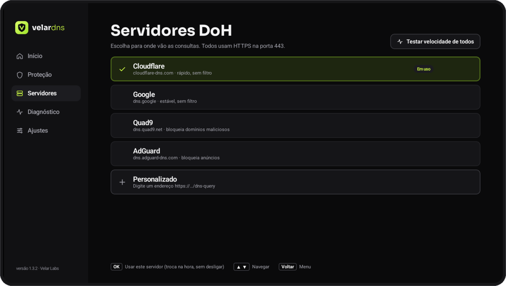
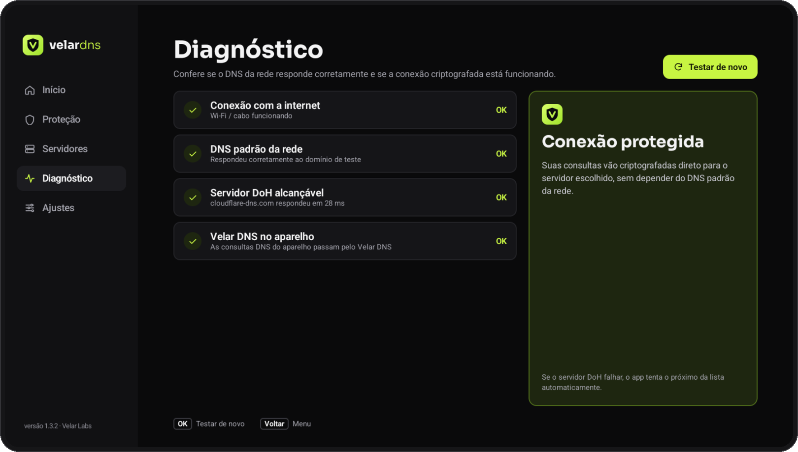
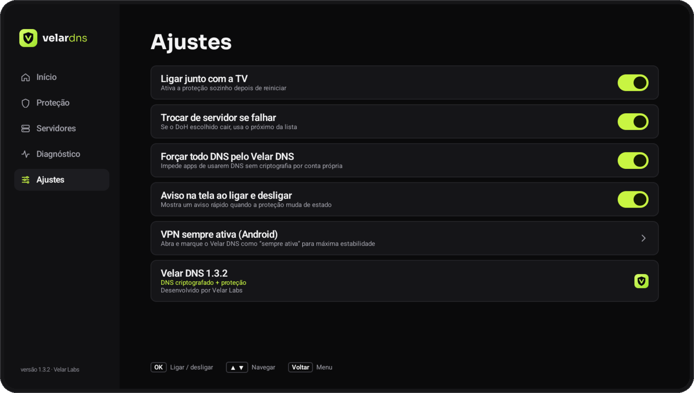
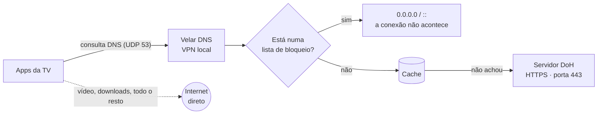

<p align="center">
  
</p>

<p align="center">
  <a href="https://github.com/Velar-Labs/velar-dns/releases/latest"></a>
  <a href="https://github.com/Velar-Labs/velar-dns/releases"></a>
  <a href="https://github.com/Velar-Labs/velar-dns/actions/workflows/build.yml"></a>
  
  
</p>

<p align="center">
  <a href="README.md">English</a> · <b>Português (Brasil)</b>
</p>

---

O **Velar DNS** criptografa todas as consultas DNS da sua TV e bloqueia domínios conhecidos de malware e phishing antes que qualquer conexão aconteça. Foi feito para a sala: um app leve, controlado inteiro pelo controle remoto, que liga junto com a TV e não atrapalha o streaming.

Só as consultas DNS passam pelo app. Vídeo, downloads e todo o resto seguem direto pela sua conexão normal — sem perda de velocidade e sem servidor de terceiros no meio.

<p align="center">
  <a href="https://github.com/Velar-Labs/velar-dns/releases/latest/download/velar-dns.apk"></a>
</p>

## Telas

<p align="center">
  
</p>

<table>
  <tr>
    <td width="50%"><p align="center"><sub>Proteção — bloqueio de domínios maliciosos</sub></p></td>
    <td width="50%"><p align="center"><sub>Servidores DoH</sub></p></td>
  </tr>
  <tr>
    <td width="50%"><p align="center"><sub>Diagnóstico</sub></p></td>
    <td width="50%"><p align="center"><sub>Ajustes</sub></p></td>
  </tr>
</table>

## Recursos

| | |
|---|---|
| 🔒 **DNS criptografado (DoH)** | As consultas vão por HTTPS (porta 443, RFC 8484) para o servidor que você escolher. Ninguém no caminho da rede consegue ler ou alterar. |
| 🛡️ **Proteção contra ameaças** | ~170 mil domínios conhecidos de malware e phishing bloqueados no próprio aparelho, antes da resolução. Domínios bloqueados recebem `0.0.0.0` (IPv4) e `::` (IPv6). |
| 🌐 **Escolha o servidor** | Cloudflare, Google, Quad9, AdGuard ou qualquer endereço DoH personalizado. Teste de velocidade de todos com um clique. |
| 🔁 **Troca automática** | Depois de 3 falhas seguidas, o Velar DNS passa sozinho para o próximo servidor. |
| ⚡ **Cache DNS** | Respostas ficam em memória pelo tempo de validade (TTL, máx. 10 min), para sites e apps abrirem mais rápido. |
| 📊 **Estatísticas no aparelho** | Bloqueios dos últimos 7 dias e domínios mais bloqueados — guardados só na TV. |
| ✅ **Liberar com um clique** | Algo legítimo foi bloqueado? Aperte **OK** sobre ele em *Bloqueios recentes* para liberar. OK de novo volta a bloquear. |
| 🩺 **Diagnóstico** | Uma tela que testa a rede, os servidores DoH e as listas de proteção. |
| 📺 **Feito para o controle remoto** | Interface em Jetpack Compose pensada para navegação pelo direcional. Liga junto com a TV e funciona com a *VPN sempre ativa* do Android. |
| 🔄 **Listas sempre atualizadas** | As listas de proteção se atualizam a cada 24 horas em segundo plano. |

## Como funciona

O Velar DNS cria uma VPN **local** no aparelho. Não é uma VPN para um servidor remoto: o túnel captura só o tráfego DNS e nunca sai da sua TV.



O app se conecta a cada servidor DoH pelos IPs fixos dele, então não depende (nem confia) no DNS da rede em que está.

## Servidores DNS

| Servidor | Endereço | Indicado para |
|---|---|---|
| **Cloudflare** | `cloudflare-dns.com` | Velocidade, sem filtro |
| **Google** | `dns.google` | Estabilidade, sem filtro |
| **Quad9** | `dns.quad9.net` | Filtro extra de domínios maliciosos no servidor |
| **AdGuard** | `dns.adguard-dns.com` | Bloqueio de anúncios |
| **Personalizado** | qualquer `https://…/dns-query` | Seu próprio provedor DoH ou outro |

## Instalação

1. Na TV, permita instalar apps de fontes desconhecidas para o app que você vai usar na instalação (navegador, gerenciador de arquivos ou um app de download).
2. Baixe o APK pelo link abaixo e abra:
   ```
   https://github.com/velar-labs/velar-dns/releases/latest/download/velar-dns.apk
   ```
   Esse link sempre aponta para a versão mais nova.
3. Abra o **Velar DNS**, aperte **OK** em **Ativar** e aceite o pedido de permissão de VPN do Android (só na primeira vez).

**Atualizar:** instale o APK novo por cima do atual. Suas configurações são mantidas.

### Configurações recomendadas

- **VPN sempre ativa:** em *Ajustes → VPN sempre ativa*, selecione o Velar DNS. É o que dá mais estabilidade.
- **DNS privado:** se a TV mostrar *"DNS privado não pode ser acessado"*, desligue o **DNS privado** nas configurações de rede do Android.

## Privacidade

- Só as consultas DNS entram no túnel. O restante do seu tráfego nunca passa pelo app.
- Listas de bloqueio, estatísticas e domínios liberados ficam **só no aparelho**. Seu histórico de DNS não é enviado a lugar nenhum.
- As listas de proteção são baixadas das fontes públicas (GitHub e phishing.army).

## Bom saber

- O Android permite só **um app de VPN** por vez. Ativar outra VPN desliga o Velar DNS.
- A religação automática depois de reiniciar depende da permissão de VPN continuar válida e do firmware de cada TV Box.
- A proteção usa cerca de **10–15 MB de RAM** para as listas de domínios — tranquilo para a maioria das TV Boxes.
- A proteção vem ligada por padrão e pode ser desligada na tela **Proteção**.

## Compilar a partir do código

Requisitos: **JDK 17** e **Android Studio Ladybug** ou mais novo.

```bash
git clone https://github.com/Velar-Labs/velar-dns.git
cd velar-dns
./gradlew assembleRelease
```

Ou no Android Studio: **Open** → selecione esta pasta → **Build → Build APK(s)**.

Todo envio para a `main` gera o APK no GitHub Actions. Como publicar versões e configurar a chave de assinatura está em [docs/RELEASING.md](docs/RELEASING.md).

<details>
<summary><b>Estrutura do projeto</b></summary>

| Caminho | O que faz |
|---|---|
| `vpn/VelarVpnService.kt` | VPN local. Endereço virtual `10.111.222.2`, DNS virtual `10.111.222.1`. Só a rota do DNS virtual (e, com *Forçar todo DNS*, a de DNS públicos conhecidos) entra no túnel. |
| `dns/Packets.kt` | Lê pacotes IPv4/UDP da porta 53 e monta as respostas. |
| `dns/Doh.kt` | Cliente DoH (RFC 8484) com IPs fixos dos servidores e troca automática. Confere cada domínio nas listas de bloqueio antes de consultar. |
| `dns/DnsCache.kt` | Cache em memória que respeita o TTL. |
| `filter/` | Motor de bloqueio: `DomainMatcher` (HashSet O(1) com subdomínios), `BlocklistManager` (download, cache e junção das listas), `BlockLog` (últimos 200 bloqueios), `BlockStats` (7 dias e domínios mais bloqueados), `BlocklistUpdater` (a cada 24 h). |
| `diag/Diagnostics.kt` | Testes da tela Diagnóstico. |
| `ui/` | Telas em Jetpack Compose, navegáveis pelo controle remoto. |

</details>

## Créditos

A proteção contra ameaças usa listas públicas mantidas pela comunidade:

- [**Steven Black hosts**](https://github.com/StevenBlack/hosts) — domínios de malware e phishing
- [**Phishing Army**](https://phishing.army) — domínios de phishing confirmados

A resolução DNS é feita pelos serviços DoH listados acima. O Velar DNS não tem vínculo com nenhum deles.

---

<p align="center">
  Desenvolvido por <b>Velar Labs</b>
</p>
